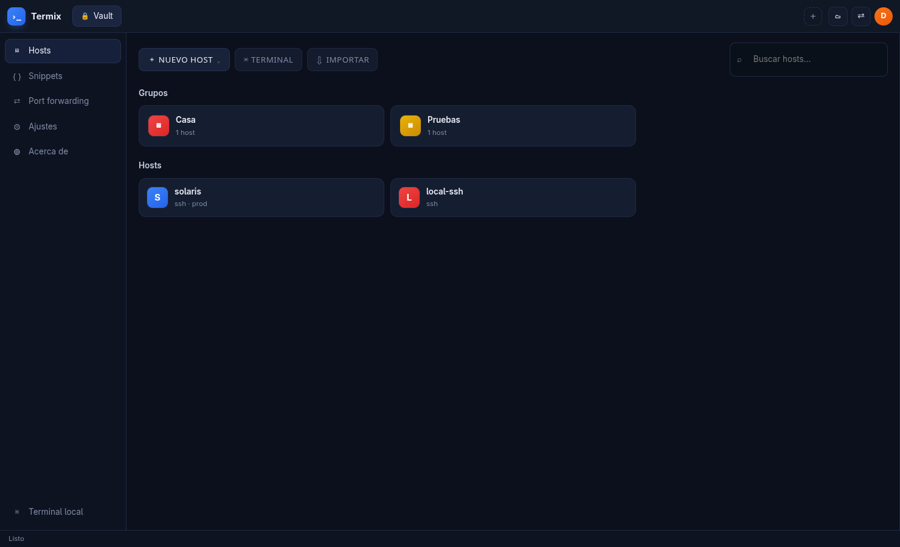
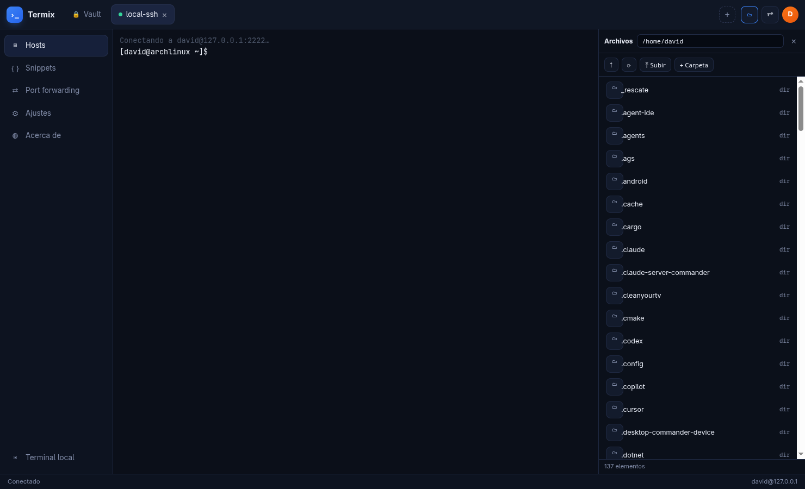
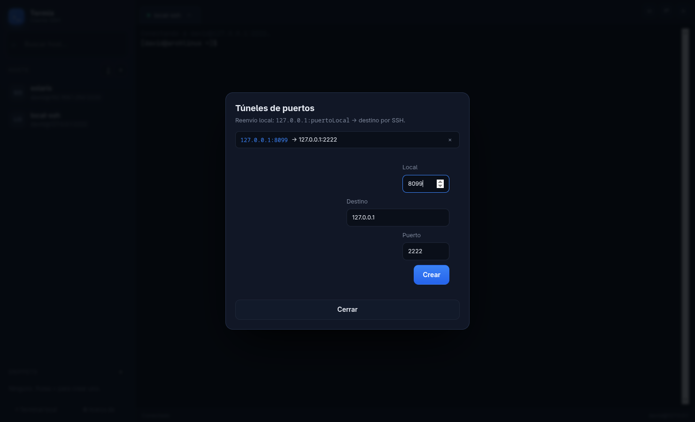
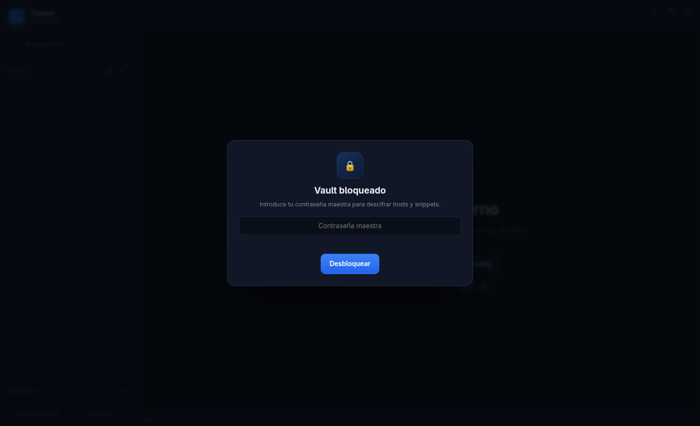
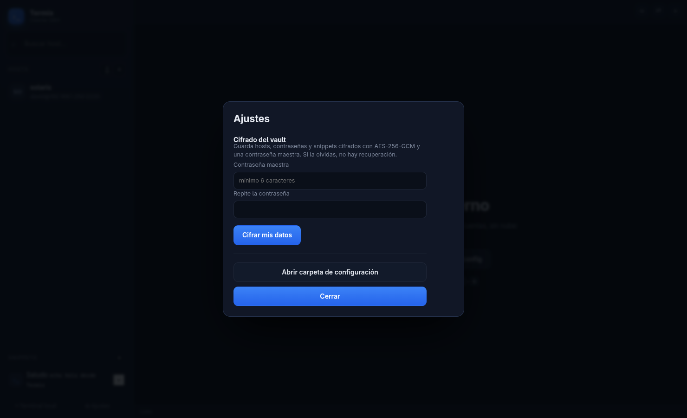

# Termix

Cliente **SSH de escritorio open source**, en español, sin cuentas ni nube.
Hecho desde cero con Electron + xterm.js + ssh2 — no contiene código de terceros.

| Vault (hosts y grupos) | Sesión SSH + SFTP |
|---|---|
|  |  |

| SFTP | Túneles |
|---|---|
|  |  |

| Vault bloqueado | Ajustes |
|---|---|
|  |  |

## Qué hace (v0.4)

- Lista de **hosts** con buscador, guardada en tu equipo (`~/.config/termix/hosts.json`).
- **Importar hosts de `~/.ssh/config`** con un botón (toma HostName, Port, User, IdentityFile).
- **Pestañas** con terminal a pantalla completa (xterm.js).
- Conexión SSH con **clave privada** (ed25519/rsa) o **contraseña**.
- Redimensionado automático del terminal y del PTY remoto.
- **Explorador SFTP** lateral: navegar, descargar, subir, crear carpeta, renombrar y borrar.
- **Túneles de puertos** locales (`-L`): `127.0.0.1:8080 → destino:80` desde un diálogo.
- **Snippets**: comandos guardados que se envían con un clic a la pestaña activa.
- **Terminal local** (pty real con `script`) sin levantarse de la app.
- **Vault cifrado**: hosts, contraseñas y snippets con contraseña maestra (scrypt + AES-256-GCM).
- Interfaz tipo cliente SSH moderno: **Vault** con grupos y hosts en rejilla, barra lateral
  de navegación (Hosts, Snippets, Port forwarding, Ajustes) y pestañas de terminal.
- Interfaz en **español**, tema oscuro, barra de estado y diálogo *Acerca de*.
- Cero telemetría, cero login.

## Instalación

```bash
git clone https://github.com/pilahito/termix.git
cd termix
npm install
npm start          # o ./start.sh
```

Si `npm start` te da `spawn …electron ENOENT` (node 26 + cli viejo), usa:

```bash
./node_modules/electron/dist/electron . --no-sandbox
```

Para tenerlo en el menú:

```bash
./scripts/instalar.sh     # lanzador ~/.local/bin/termix + entrada .desktop
```

## Uso

1. **+** en la barra lateral → nombre, host/IP, puerto, usuario.
2. Autenticación: *clave privada* (ruta a tu clave) o *contraseña*.
3. Pulsa el host → se abre la pestaña y conecta.
4. `×` en la pestaña cierra la sesión.

Los hosts se guardan en `~/.config/termix/hosts.json` (visible desde el pie:
*Abrir carpeta de configuración*).

## Hoja de ruta

- [ ] contraseña de host que se pregunte al conectar (no guardada)
- [ ] ~/.ssh/config: importar aliases automáticamente
- [ ] llaves SSH y **passphrase**
- [ ] **SFTP** (subir/bajar ficheros) en otra pestaña
- [ ] **port forwarding** (`-L`, `-R`)
- [ ] sesión local (shell de tu equipo) con pty
- [ ] grupos/etiquetas y buscar hosts
- [ ] temas de color (Catppuccin, Nord)
- [ ] empaquetado AppImage / .deb

## Cómo está hecho

```
src/main.js        proceso principal: ventana, IPC, conexiones con ssh2
src/preload.js     puente seguro (contextIsolation, sin nodeIntegration)
src/renderer/      interfaz: DOM + xterm.js (UMD), sin frameworks
  app.js           hosts, pestañas, terminales
  styles.css       tema oscuro
  assets/          xterm.js, addon-fit, css
```

- La conexión SSH vive en el **proceso principal**; el renderer solo pinta y
  manda teclas (`contextIsolation: true`, `nodeIntegration: false`).
- Cada sesión tiene su `id`; los datos viajan con `ssh:data:<id>`.

## Seguridad

- Sin `nodeIntegration` en el renderer; CSP estricta en `index.html`.
- Las credenciales de las conexiones no salen del proceso principal.
- Los hosts se guardan en JSON plano **por ahora**; el cifrado del vault está en
  la hoja de ruta (la idea es AES con clave derivada de una contraseña maestra).

## Licencia

MIT. Inspirado en la idea de Termius, **sin usar su código ni sus recursos**.
